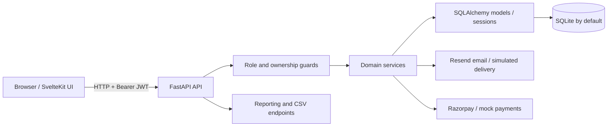

# Brightloop — Subscription & Billing Management

A role-based, full-stack subscription management application for managing customers, products, recurring plans, quotations, subscriptions, invoices, payments, and revenue reporting. Brightloop provides an internal workspace for administrators and staff alongside a self-service customer portal.

> **Project status:** Hackathon/development project. The documented capabilities come from the current `main` branch's **frontend and backend source code**, not only its commit history. The demo credentials and example records below are development seed data—never use them in production.

## What it does

Brightloop brings the main stages of a subscription business together:

1. **Set up a catalog** of products, product options/variants, plans, payment terms, taxes, discounts, and quotation templates.
2. **Manage customers** and create subscriptions, including subscriptions based on reusable quotation templates.
3. **Move subscriptions through their lifecycle** (draft, quotation, confirmed, active, paused, and closed), using the actions permitted by their status and plan rules.
4. **Generate and manage invoices**, run billing, record payments, and track outstanding balances.
5. **Let customers manage their own records** in a restricted portal, including eligible subscription actions, invoices, payments, and profile information.
6. **Monitor operations** through dashboard KPIs, revenue charts, overdue invoices, upcoming renewals, and CSV exports.

## Tech stack

| Layer | Technologies used in the repository |
| --- | --- |
| Frontend | **Svelte 5**, **SvelteKit 3**, JavaScript with TypeScript checking, **Vite 8** |
| UI | **Tailwind CSS 4**, Bits UI/shadcn-style components, Lucide icons, GSAP, Sonner notifications |
| Data and validation | TanStack Svelte Query, `openapi-fetch`, Zod, generated OpenAPI typings |
| Backend | **Python**, **FastAPI**, Uvicorn, Pydantic / Pydantic Settings |
| Persistence | SQLAlchemy 2; **SQLite by default** |
| Authentication | JWT bearer tokens, Argon2 password hashing, role-based API guards |
| Payments | Payment records, a development mock-payment path, and **Razorpay** order/payment-link/signature integration |
| Email | Resend integration; simulated delivery when unconfigured or testing |
| Testing/tooling | Pytest, Vitest, Playwright, ESLint, Prettier, `svelte-check` |

## Features by role

| Area | Admin | Staff | Customer |
| --- | :---: | :---: | :---: |
| Sign in / manage own account | ✅ | ✅ | ✅ |
| View staff operations dashboard | ✅ | ✅ | — |
| Invite / manage staff users | ✅ | — | — |
| List / manage customer records | ✅ | ✅ | Own profile only |
| View product, plan, payment-term and tax catalogs | ✅ | ✅ | — |
| Create / edit products, plans, payment terms, templates, and tax rules | ✅ | — | — |
| Manage subscriptions and quotations | ✅ | ✅ | Own subscriptions and permitted actions |
| View / manage internal invoices and payment records | ✅ | ✅ | Own invoices and payments |
| Trigger and inspect billing runs | ✅ | ✅ | — |
| View revenue reporting and export CSV | ✅ | ✅ | — |

Permissions are enforced in backend routes, not just hidden in the frontend. Certain operations have additional lifecycle/state restrictions.

### Admin workspace

- Dashboard showing revenue collected, outstanding invoices, active subscriptions, monthly recurring revenue (MRR), overdue totals, monthly revenue trends, and upcoming renewals.
- Staff invitations and account activation/deactivation.
- Customer listing and customer profile management.
- Product setup with sales/cost prices, taxes, attributes, variants, and additional variant prices.
- Plan setup with billing frequency, minimum quantity, pause/renew/close rules, and availability.
- Payment terms, quotation templates, tax rates, and fixed/percentage discounts.
- Subscription creation and editing, quotation flows, plan-related state transitions, and status histories.
- Invoice confirmation/cancellation/sending, PDF access, payment recording, billing runs, and reporting.

### Staff workspace

- Day-to-day customer, quotation, subscription, invoice and billing operations.
- Read-only access to catalog/rule configuration where the corresponding backend endpoints are admin-only.
- Internal dashboard, subscription histories, payment records, and financial reporting.

### Customer portal

- View their own subscriptions, details, state histories, and eligible actions (such as pausing, resuming, renewing, or closing **when allowed**).
- View their own invoices, download invoice PDFs, view payment history, and pay eligible invoices through the available mock/Razorpay flows.
- View and update their customer profile.
- Access is scoped to the authenticated customer's records; draft subscriptions are excluded from customer-facing subscription lists.

## Demo accounts (seeded login credentials)

These credentials are **hardcoded in `backend/scripts/seed.py`** and are created when you run the database seed command below:

| Role | Name | Email | Password | Landing page |
| --- | --- | --- | --- | --- |
| **Admin** | System Administrator | `admin@brightloop.io` | `BrightloopAdmin@123` | `/app/dashboard` |
| **Staff** | Operations Staff | `staff@brightloop.io` | `BrightloopStaff@123` | `/app/dashboard` |
| **Customer** | Rohith Sarath | `customer@brightloop.io` | `BrightloopCust@123` | `/portal/subscriptions` |

The demo customer's linked company is **Acme Corporation Ltd**. The seed also supplies sample phone, address and tax fields for that customer.

**Important differences between hardcoded settings and seeded accounts:**

- `backend/.env.example` and `backend/app/core/config.py` also declare bootstrap defaults (`admin@brightloop.test` / `BrightloopAdmin@123`). **Those configuration values are not the login account created by `scripts/seed.py`.** Use the `@brightloop.io` accounts in the table after seeding.
- The seed includes other sample customer records (listed below), but their associated users are populated with placeholder `password_hash` values. **Do not treat those addresses as working login credentials.** Use `customer@brightloop.io` or register a new customer through `/signup`.
- Do not commit real keys or actual user passwords. Change the default JWT secret and demo account passwords before deploying to a shared environment.

## Hardcoded development / seed data

The demo dataset is maintained on the backend, primarily in `backend/scripts/seed.py` and `backend/scripts/seed_parts/catalog_subs.py`. The main frontend screens fetch live API resources; example seed rows should not be confused with fixed dashboard results.

### Additional customer organizations (sample records, **not** demo logins)

| Organization | Seeded email |
| --- | --- |
| Tata Consultancy Group | `tata@brightloop.local` |
| Reliance Digital Works | `reliance@brightloop.local` |
| Infosys Solutions Ltd | `infosys@brightloop.local` |
| Wipro Enterprises | `wipro@brightloop.local` |
| HDFC Financial Services | `hdfc@brightloop.local` |
| Zomato Tech Hub | `zomato@brightloop.local` |

The sample script also creates **12 products**, including Odoo ERP, User Seat License, Cloud Storage 500GB, Priority Support SLA, Advanced Analytics Module, POS Terminal Integration, and Essential Starter Kit. Products can have attribute values with additional prices; for example, Odoo ERP is seeded at a base sales price of **₹1,000** and its **Odoo** brand variant adds **₹560**.

**Seeded subscription plans:**

| Plan | Base price | Period |
| --- | ---: | --- |
| Basic Monthly | ₹1,500 | Monthly |
| Enterprise Yearly | ₹15,000 | Yearly |
| Weekly Sprint | ₹400 | Weekly |
| Daily Demo Plan | ₹50 | Daily |
| Pay-As-You-Go (Zero Base Fee) | ₹0 | Monthly |

Other included examples:

- **Taxes:** GST 0% (exempt), GST 5%, GST 12%, GST 18%.
- **Payment terms:** Immediate, Net 15, Net 30, Net 60.
- **Quotation templates:** SME Standard ERP Starter, Enterprise Full Cloud Suite, Fast Track Onboarding, Modular Custom Cloud.
- **Discount:** Launch Special 10%.
- **Subscriptions:** A sample set across draft, quotation, confirmed, active, paused, closed, and renewal scenarios.

Seed results can depend on what is already in the database; the script checks for existing records in several places.

## Getting started

### Prerequisites

- **Git**
- **Python 3.11+** recommended, with `pip` and support for Python virtual environments
- **Node.js 22.12+** (required by the frontend's `package.json`) and npm
- No external database server is required for the default SQLite configuration.

### 1. Clone the repository

```bash
git clone https://github.com/fahimshafeek/odoo-hack.git
cd odoo-hack
```

### 2. Configure and run the backend

In a terminal, from the repository root:

```bash
cd backend
python -m venv .venv
```

Activate the virtual environment:

```bash
# Windows PowerShell
.\.venv\Scripts\Activate.ps1

# macOS / Linux
source .venv/bin/activate
```

Then install packages and copy the sample environment:

```bash
python -m pip install -r requirements.txt

# macOS / Linux
cp .env.example .env

# Windows PowerShell equivalent
# Copy-Item .env.example .env
```

For local development, the default configuration uses `sqlite:///./brightloop.db`. Make sure the backend `.env` has a unique development `JWT_SECRET`.

**Load the demo users and sample data:**

```bash
python -m scripts.seed
```

To rebuild an existing **development** database from scratch instead:

```bash
python -m scripts.seed --reset
```

> **Warning:** `--reset` drops and recreates the application's tables, deleting existing records. Do not run it against a database you need to keep.

Start the API:

```bash
uvicorn app.main:app --reload --host 127.0.0.1 --port 8000
```

- Backend: **http://localhost:8000**
- Interactive API documentation: **http://localhost:8000/docs**
- API health endpoint: **http://localhost:8000/health**

### 3. Configure and run the frontend

In a **second terminal**, from the repository root:

```bash
cd frontend
npm install
```

Create `frontend/.env` from `frontend/.env.example`:

```env
VITE_API_URL=http://localhost:8000
VITE_USE_MOCKS=false
```

Run the SvelteKit development server:

```bash
npm run dev
```

Open **http://localhost:5173** and sign in with any of the seeded demo accounts above.

### Quick verification

1. Visit `/health` on port `8000` and check for an `ok` response.
2. Sign in as **admin**, then open the dashboard, products and subscriptions.
3. Sign in as **staff** and check internal operational pages.
4. Sign in as **customer** and check **My subscriptions**, **My invoices**, and **Payment history**.

## Environment variables

### Backend (`backend/.env`)

| Variable | Purpose | Development example |
| --- | --- | --- |
| `ENV` | Runtime environment | `dev` |
| `PORT` | Configured API port | `8000` |
| `FRONTEND_BASE_URL` | Frontend base URL used in links/emails | `http://localhost:5173` |
| `DATABASE_URL` | SQLAlchemy database connection | `sqlite:///./brightloop.db` |
| `JWT_SECRET` | JWT signing secret | **Set your own secret** |
| `JWT_EXPIRE_HOURS` | Access-token lifetime | `8` |
| `PASSWORD_RESET_EXPIRE_MINUTES` | Password-reset link lifetime | `5` |
| `RESEND_API_KEY` | Email delivery via Resend | Empty = simulated delivery |
| `EMAIL_FROM` | Outgoing sender address | A verified sender for real email |
| `BOOTSTRAP_ADMIN_EMAIL` / `BOOTSTRAP_ADMIN_PASSWORD` | Bootstrap settings (separate from seed logins) | See `.env.example` |
| `RAZORPAY_KEY_ID` / `RAZORPAY_KEY_SECRET` | Razorpay credentials | Placeholder values for local testing |
| `RAZORPAY_WEBHOOK_SECRET` | Razorpay webhook signature verification | Set when integrating webhooks |

### Frontend (`frontend/.env`)

| Variable | Purpose |
| --- | --- |
| `VITE_API_URL` | Base URL of the FastAPI backend; defaults to `http://localhost:8000` in the frontend API client |
| `VITE_USE_MOCKS` | Development mock flag; set `false` when connecting to the live backend |

### Integrations and demo-mode behavior

- **Razorpay:** Real Razorpay API calls require configured test/live credentials. With the repository's placeholder key, order generation takes a development/offline mock path. Do not mistake that path for a settled real payment.
- **Resend:** Without `RESEND_API_KEY`, email sending is simulated/logged rather than delivered to an inbox.
- **Invoice PDF:** The backend has an HTML invoice template and a PDF generator. It uses WeasyPrint **if installed** and falls back to a minimal PDF otherwise. WeasyPrint is not listed in the current backend `requirements.txt`.

## Application routes

The frontend uses a central route registry in `frontend/src/app/routes.js`; these are the route groups exposed by its feature modules:

| Route | Intended use | Role |
| --- | --- | --- |
| `/login`, `/signup`, `/forgot-password`, `/reset-password` | Authentication and password recovery | Public |
| `/app/dashboard` | Revenue and operations overview | Admin, Staff |
| `/app/staff` | Staff management | Admin |
| `/app/customers`, `/app/customers/:id` | Customer management | Admin, Staff |
| `/app/catalog/products`, `/app/catalog/plans` | Product and plan catalog | Admin, Staff |
| `/app/catalog/payment-terms` | Payment terms | Admin, Staff |
| `/app/quotation-templates` | Quotation templates | Admin |
| `/app/rules/taxes`, `/app/rules/discounts` | Pricing rules | Admin, Staff (editing restricted by API) |
| `/app/subscriptions`, `/app/subscriptions/new`, `/app/subscriptions/:id` | Subscription operations | Admin, Staff |
| `/app/invoices`, `/app/invoices/:id` | Invoices | Admin, Staff |
| `/app/payments`, `/app/billing-runs` | Payments and billing runs | Admin, Staff |
| `/portal/subscriptions`, `/portal/subscriptions/:id` | Own subscriptions | Customer |
| `/portal/invoices`, `/portal/invoices/:id` | Own invoices | Customer |
| `/portal/payments` | Own payment history | Customer |
| `/portal/profile` | Own profile | Customer |

## Backend API overview

FastAPI exposes REST endpoints from dedicated domain routers. The interactive `/docs` page is the source of truth for exact request/response schemas.

| Module | Representative endpoints | Purpose |
| --- | --- | --- |
| Authentication | `POST /auth/signup`, `POST /auth/login`, `GET /auth/me`, `POST /auth/forgot-password`, `POST /auth/reset-password` | Accounts and JWT sessions |
| Staff/customers | `GET/POST /staff`, `PATCH /staff/{id}`, `GET/POST /customers`, `GET /me/profile` | Staff and customer management |
| Catalog | `GET/POST /products`, `GET/POST /plans`, `GET/POST /payment-terms`, `GET/POST /quotation-templates` | Configurable catalog |
| Subscriptions | `GET/POST /subscriptions`, `POST /subscriptions/price-preview`, `POST /subscriptions/from-template/{id}`, `POST /subscriptions/{id}/transition` | Pricing and lifecycle |
| Customer subscriptions | `GET /me/subscriptions`, `POST /me/subscriptions/{id}/actions` | Portal self-service |
| Billing | `GET /invoices`, `GET /invoices/{id}`, `POST /invoices/{id}/confirm`, `GET /invoices/{id}/pdf` | Invoices |
| Billing runs | `POST /billing/run`, `GET /billing/runs` | Recurring billing execution and history |
| Payments | `POST /invoices/{id}/payments`, `GET /payments`, `GET /me/payments` | Recording and viewing payments |
| Razorpay | `POST /me/invoices/{id}/razorpay/order`, `POST /me/invoices/{id}/razorpay/link` | Online payment setup |
| Reports | `GET /reports/summary`, `GET /reports/revenue-by-month`, `GET /reports/overdue-invoices`, `GET /reports/upcoming-renewals`, `GET /reports/export.csv` | KPIs and exports |
| System | `GET /health` | Health check |

Most protected endpoints expect the header:

```http
Authorization: Bearer <access_token>
```

## Repository structure

```text
odoo-hack/
├── M1/ M2/ M3/ M4/          # Additional milestone directories
├── backend/
│   ├── .env.example          # API, database, JWT, email, and payment settings
│   ├── requirements.txt      # Python packages
│   ├── app/
│   │   ├── main.py           # FastAPI application, middleware, router mounting
│   │   ├── core/             # Settings, SQLAlchemy, security, dependencies, email
│   │   ├── auth/             # Login, signup, roles, staff, customers, profiles
│   │   ├── catalog/          # Products, plans, terms and quotation templates
│   │   ├── subscriptions/    # Lifecycle, pricing, transitions, portal APIs
│   │   ├── billing/          # Invoice workflows, taxes, discounts, billing runs, PDFs
│   │   ├── payments/         # Payment records and Razorpay integration
│   │   └── reports/          # Dashboard figures, reports and CSV exports
│   └── scripts/
│       ├── seed.py           # Admin/staff/customer logins and base demo data
│       └── seed_parts/
│           └── catalog_subs.py  # Example catalog, plans, templates and subscriptions
└── frontend/
    ├── .env.example          # API URL and mock flag
    ├── package.json          # npm scripts and frontend dependencies
    ├── vite.config.js        # Vite dev server and tooling
    ├── scripts/              # Preview, API-codegen, and static-data checks
    └── src/
        ├── app/routes.js     # Central route registry
        ├── routes/           # SvelteKit entry/catch-all routing
        ├── api/              # OpenAPI client and query/mutation helpers
        ├── lib/              # Auth session, shared components and utilities
        └── features/
            ├── auth/         # Login, signup, password reset
            ├── dashboard/    # KPI cards, revenue and report views
            ├── staff/        # Staff directory and dialogs
            ├── customers/    # Customer listing/details
            ├── catalog/      # Products, plans, terms, templates
            ├── rules/        # Taxes and discounts
            ├── subscriptions/ # Subscription forms, lists and detail views
            ├── billing/      # Invoices, payments, billing runs
            ├── portal/       # Customer route definitions
            ├── payment-history/
            └── profile/
```

## Architecture and data flow



- Svelte feature pages call the shared `frontend/src/api/resources.js` layer; `openapi-fetch` talks to the backend at `VITE_API_URL`.
- The browser session stores an access token and refreshes user identity by calling `/auth/me`. Backend JWT/role/ownership checks protect resources.
- The API organizes behavior into authentication, catalog, subscriptions, billing, payments, and reports.
- SQLAlchemy persists domain models; the app creates missing database tables at startup.

## Development commands

Run these from their respective subdirectories.

**Frontend (`frontend/`)**

```bash
npm run dev          # Development server
npm run build        # Production build
npm run preview      # Preview production build
npm run check        # Svelte / TypeScript checks
npm run lint         # Prettier + ESLint checks
npm run test         # Vitest unit tests
npm run e2e          # Playwright browser tests
npm run gen:api      # Regenerate frontend API types from backend OpenAPI
npm run check:static # Static-data policy check
```

**Backend (`backend/`, with virtual environment active)**

```bash
python -m pytest                 # Run backend tests
python -m scripts.seed           # Add demo dataset
python -m scripts.seed --reset   # Recreate database and demo dataset (destructive)
uvicorn app.main:app --reload    # Start local API (default port 8000)
```

## Notes for contributors / deployment

- **Development only:** The seeded accounts and placeholder keys are intentionally known values; do not carry them into production.
- **Separate configuration from sample data:** `.env.example` contains bootstrap defaults, while `scripts/seed.py` contains the documented usable seed logins.
- **Customer records are not all customer logins:** The six example organizations use placeholder password hashes; use the dedicated seeded customer account for portal demonstrations.
- **Payments and email have simulated paths:** Configure actual credentials and verify payment/webhook behavior before accepting money or sending customer email in production.
- **Security review required before deployment:** In particular, the billing router contains a testing-oriented mock-role fallback; it should not be exposed in a production API. Validate authorization, secrets, error handling, and payment reconciliation before release.
- **Database initialization is not a migration system:** The current startup calls `create_all`; consider a migration workflow when changing schemas for an existing environment.
- **Do not assume everything is production-tested:** Endpoints, frontend controls, and tests are present in the code, but this README does not claim a successful end-to-end execution or live gateway verification.

## Source code references

The following files were used to verify the documentation:

- [Backend app/router registration](backend/app/main.py)
- [Backend auth/role endpoints](backend/app/auth/router.py)
- [Catalog endpoints](backend/app/catalog/router.py)
- [Subscription endpoints](backend/app/subscriptions/router.py)
- [Billing and payment endpoints](backend/app/billing/router.py)
- [Report endpoints](backend/app/reports/router.py)
- [Seeded demo accounts](backend/scripts/seed.py)
- [Seeded catalog and sample customers](backend/scripts/seed_parts/catalog_subs.py)
- [Frontend package/scripts](frontend/package.json)
- [Frontend route registry](frontend/src/app/routes.js)
- [Frontend API resource layer](frontend/src/api/resources.js)
- [Frontend authenticated session](frontend/src/lib/auth/session.js)
- [Frontend dashboard](frontend/src/features/dashboard/Dashboard.svelte)

---

**Brightloop** — one workspace for subscription operations and one self-service portal for customers.
